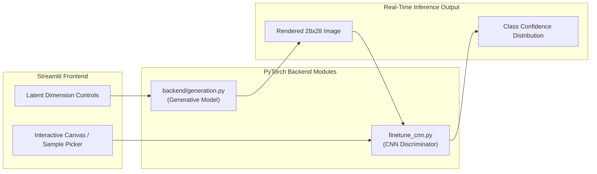

<p align="center">
  
</p>

<p align="center">
  
  
  
  
</p>

<a id="overview"></a>
## 📖 Executive Summary & Overview

Machine learning models divide fundamentally into **Discriminative** approaches (modeling $P(Y|X)$, estimating decision boundaries) and **Generative** approaches (modeling $P(X)$ or $P(X,Y)$, capturing underlying data distributions). Visualizing this theoretical contrast in a live, interactive environment clarifies model behavior for students and engineers.

The **Generative vs Discriminative Model Lab** is a full-featured web application engineered with **Streamlit** and **PyTorch**. The application enables users to generate synthetic handwritten digits across latent manifolds while evaluating how a fine-tuned Convolutional Neural Network (CNN) perceives, classifies, and assigns confidence bounds to both synthetic and handwritten inputs.

<a id="toc"></a>
## 📑 Table of Contents

- [📖 Executive Summary & Overview](#overview)
- [🎯 Key Features & Capabilities](#features)
- [🏗️ System Architecture & Pipeline](#architecture)
- [🛠️ Tech Stack Breakdown](#tech-stack)
- [⚙️ Reproducible Quickstart & Setup](#setup)
- [📁 Project Directory Layout](#project-layout)
- [👨‍💻 Author & Contributions](#author)

<a id="features"></a>
## 🎯 Key Features & Capabilities

- **Interactive Streamlit Web Dashboard:** Clean, responsive UI with real-time slider controls for latent vector tuning.
- **High-Accuracy CNN Classifier:** Convolutional neural network trained with data augmentation achieving >99% test accuracy on MNIST.
- **Generative Synthesis Engine:** Real-time generation of custom handwritten digits from latent seeds.
- **Classification Confidence Visualizer:** Softmax probability bar charts detailing class distributions for synthetic images.
- **Automated Verification Harness:** `test_handwriting.py` and `generate_test_and_screenshots.py` for headless automated regression testing.

<a id="architecture"></a>
## 🏗️ System Architecture & Pipeline



<a id="tech-stack"></a>
## 🛠️ Tech Stack Breakdown

| Component | Library / Framework | Function |
| :--- | :--- | :--- |
| **Frontend Framework** | Streamlit | Reactive web dashboard, sliders, and image rendering |
| **Deep Learning Engine** | PyTorch / Torchvision | Tensor operations, CNN architecture, and inference |
| **Data Processing** | NumPy, Pandas, Pillow (PIL) | Pixel array manipulation, normalization, image export |
| **Automation & Testing** | Pytest, Custom Test Harnesses | Headless UI validation and model convergence tests |

<a id="setup"></a>
## ⚙️ Reproducible Quickstart & Setup

### Prerequisites
- Python 3.9+

```bash
# 1. Clone repository
git clone https://github.com/Amaraiah11/Generative_AI-TEST.git
cd Generative_AI-TEST

# 2. Create virtual environment
python -m venv venv
venv\Scripts\activate   # Windows

# 3. Install dependencies
pip install -r requirements.txt

# 4. Launch web application
streamlit run app.py
```

<a id="project-layout"></a>
## 📁 Project Directory Layout

```text
Generative_AI-TEST/
├── app.py                             # Main Streamlit web application
├── finetune_cnn.py                    # High-accuracy CNN classifier fine-tuning script
├── generate_test_and_screenshots.py  # Automated visual regression test harness
├── test_handwriting.py                # Unit and integration test suite
├── train_all.py                       # Comprehensive training coordinator
├── digits_100.csv                     # Sample benchmark handwritten digits dataset
├── backend/
│   └── generation.py                  # Generative model architecture & inference logic
├── requirements.txt                   # Production dependencies
└── README.md                          # Interactive lab documentation
```

<a id="author"></a>
## 👨‍💻 Author & Contributions

This project is developed and maintained with high technical rigour by **Amaraiah C**, Software Engineer and Data Analytics Practitioner studying Bachelor of Computer Applications (BCA) at Alliance University.

- 🌐 **GitHub:** [@Amaraiah11](https://github.com/Amaraiah11)
- 💼 **LinkedIn:** [Connect on LinkedIn](https://www.linkedin.com/in/amaraiah-c/)
- 📧 **Institutional Contact:** `camaraiahBCA24@ced.alliance.edu.in`

### 🤝 Contribution Guidelines
Contributions, bug reports, and architectural discussions are welcome!
1. **Fork** the repository: `https://github.com/Amaraiah11/Generative_AI-TEST`
2. **Branch**: `git checkout -b feature/your-feature-name`
3. **Commit**: `git commit -m "feat: enhance feature logic"`
4. **Push**: `git push origin feature/your-feature-name`
5. **Open Pull Request** against the `Amaraiah-C` branch.

---

<p align="center">
  <b>⭐ If this codebase or documentation assisted your engineering workflows, please star the repository! ⭐</b>
</p>

<p align="center">
  
</p>
