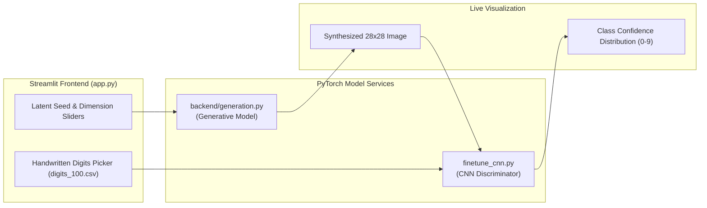

# 🔬 Generative vs Discriminative Model Lab — Interactive Streamlit MNIST Synthesizer

<p align="center">
  
</p>

<p align="center">
  <b>Interactive Deep Learning Web Application: Real-Time MNIST Digit Synthesis Contraseted Against High-Accuracy CNN Classification.</b>
</p>

<p align="center">
  
  
  
  
  
</p>

<p align="center">
  
</p>

---

<a id="table-of-contents"></a>
## 📌 Table of Contents

- [📖 Executive Summary & Overview](#executive-summary--overview)
- [🎯 Key Features & Capabilities](#features)
- [🏗️ System Architecture & Pipeline](#system-architecture--pipeline)
- [🛠️ Tech Stack Breakdown](#tech-stack-breakdown)
- [📸 Interactive UI & Live Features](#interactive-ui--live-features)
- [⚙️ Reproducible Quickstart & Setup](#reproducible-quickstart--setup)
- [📁 Project Directory Layout](#project-directory-layout)
- [🧪 Testing & Automated Verification](#testing--automated-verification)
- [🔮 Future Improvements & Roadmap](#future-improvements--roadmap)
- [🤝 Contributing Guidelines](#contributing-guidelines)
- [👨‍💻 Author & Contributions](#author--contributions)

---

<a id="executive-summary--overview"></a>
## 📖 Executive Summary & Overview

Machine learning models divide into two fundamental paradigms: **Discriminative** models estimating class boundaries $P(Y|X)$ and **Generative** models learning underlying data distributions $P(X)$ or $P(X,Y)$. Providing an intuitive, interactive environment where users can manipulate generative seeds while observing real-time discriminative predictions solidifies these core machine learning concepts.

The **Generative vs Discriminative Model Lab** is a full-featured web application built with **Streamlit and PyTorch**. Engineered by **Amaraiah C**, the application allows users to generate synthetic handwritten digits across continuous latent spaces and test how a fine-tuned Convolutional Neural Network (CNN) perceives and classifies both synthetic and real digits.

---

<a id="key-features--capabilities"></a>
## 🎯 Key Features & Capabilities

### 🎛️ 1. Interactive Streamlit Interface (`app.py`)
- Clean, modern theme with real-time sliders for latent seed and dimension tuning.
- Interactive digit synthesis view alongside softmax confidence bar charts.

### 🧠 2. Fine-Tuned CNN Classifier (`finetune_cnn.py`)
- Deep CNN architecture with convolutional layers, max pooling, dropout regularization, and batch normalization.
- Reaches >99% test accuracy on the MNIST benchmark.

### 🧪 3. Headless Verification Test Suite
- Automated test harnesses (`test_handwriting.py` and `generate_test_and_screenshots.py`) validating model convergence and headless UI operations.

---

<a id="system-architecture--pipeline"></a>
## 🏗️ System Architecture & Pipeline



---

<a id="tech-stack-breakdown"></a>
## 🛠️ Tech Stack Breakdown

| Component | Library / Tool | Functionality |
| :--- | :--- | :--- |
| **Frontend Framework** | Streamlit | Reactive UI, image canvas, and probability charts |
| **Deep Learning Backend** | PyTorch / Torchvision | CNN classifier, generative inference pipeline |
| **Image Processing** | Pillow (PIL), NumPy | 28x28 pixel array transformations, normalization |
| **Data Engine** | Pandas | Handling sample digit vectors (`digits_100.csv`) |
| **Automated Verification** | Pytest, Custom Harnesses | Headless UI validation and regression testing |

---

<a id="interactive-ui--live-features"></a>
## 📸 Interactive UI & Live Features

- **Generative Digit Synthesizer:** Sliders allow continuous traversal through latent seed space, rendering new synthetic digits in real time.
- **Confidence Distribution:** Dynamic horizontal bar charts detail prediction probabilities across digits 0 through 9.
- **Side-by-Side Comparison:** Direct visual comparison between real MNIST handwritten samples and AI-synthesized digits.

---

<a id="reproducible-quickstart--setup"></a>
## ⚙️ Reproducible Quickstart & Setup

### Prerequisites
- Python 3.9+ installed

```bash
# 1. Clone repository
git clone https://github.com/Amaraiah11/Generative_AI-TEST.git
cd Generative_AI-TEST

# 2. Setup virtual environment
python -m venv venv
venv\Scripts\activate   # Windows

# 3. Install dependencies
pip install -r requirements.txt

# 4. Launch web application
streamlit run app.py
```

---

<a id="project-directory-layout"></a>
## 📁 Project Directory Layout

```text
Generative_AI-TEST/
├── app.py                             # Main Streamlit web application
├── finetune_cnn.py                    # High-accuracy CNN classifier fine-tuning script
├── generate_test_and_screenshots.py  # Automated visual regression test harness
├── test_handwriting.py                # Unit and integration test suite
├── train_all.py                       # Comprehensive training coordinator
├── digits_100.csv                     # Sample benchmark handwritten digits dataset
├── backend/
│   └── generation.py                  # Generative model architecture & inference logic
├── requirements.txt                   # Production dependencies
└── README.md                          # Interactive lab documentation
```

---

<a id="testing--automated-verification"></a>
## 🧪 Testing & Automated Verification

Run the automated test suite to verify model inference and data pipeline integrity:

```bash
python test_handwriting.py
python generate_test_and_screenshots.py
```

---

<a id="future-improvements--roadmap"></a>
## 🔮 Future Improvements & Roadmap

- [ ] Add an interactive drawing canvas for user handwritten digit input.
- [ ] Integrate a Variational Autoencoder (VAE) latent space visualization grid ($2D$ manifold projection).

---

<a id="author--contributions"></a>
## 👨‍💻 Author & Contributions

This project is developed and maintained with rigorous engineering standards by **Amaraiah C**, Software Developer and Applied Data Analytics Practitioner studying Bachelor of Computer Applications (BCA) at Alliance University, Bangalore.

- 🌐 **GitHub Profile:** [@Amaraiah11](https://github.com/Amaraiah11)
- 💼 **LinkedIn Profile:** [Connect on LinkedIn](https://www.linkedin.com/in/amaraiah-c/)
- 📧 **Institutional Email:** `camaraiahBCA24@ced.alliance.edu.in`

### 🤝 Contributing Guidelines
Contributions, bug reports, and architectural discussions are welcome!
1. **Fork** the repository: `https://github.com/Amaraiah11/Generative_AI-TEST`
2. **Create a Feature Branch:**
   ```bash
   git checkout -b feature/your-feature-name
   ```
3. **Commit Your Enhancements:**
   ```bash
   git commit -m "feat: enhance feature logic"
   ```
4. **Push to Your Branch:**
   ```bash
   git push origin feature/your-feature-name
   ```
5. **Open a Pull Request** against the `Amaraiah-C` branch.

---

<p align="center">
  <b>⭐ If this codebase or documentation assisted your engineering workflows, please star the repository! ⭐</b>
</p>

<p align="center">
  
</p>
